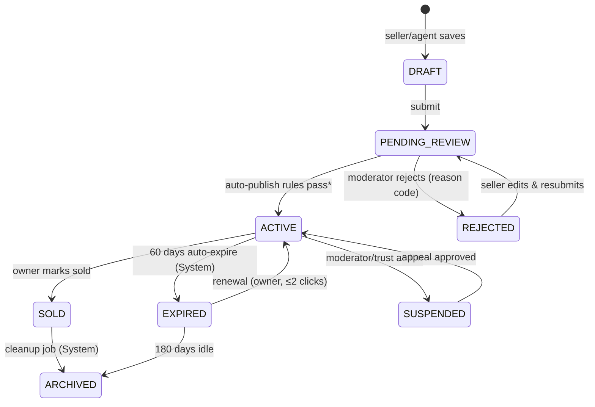
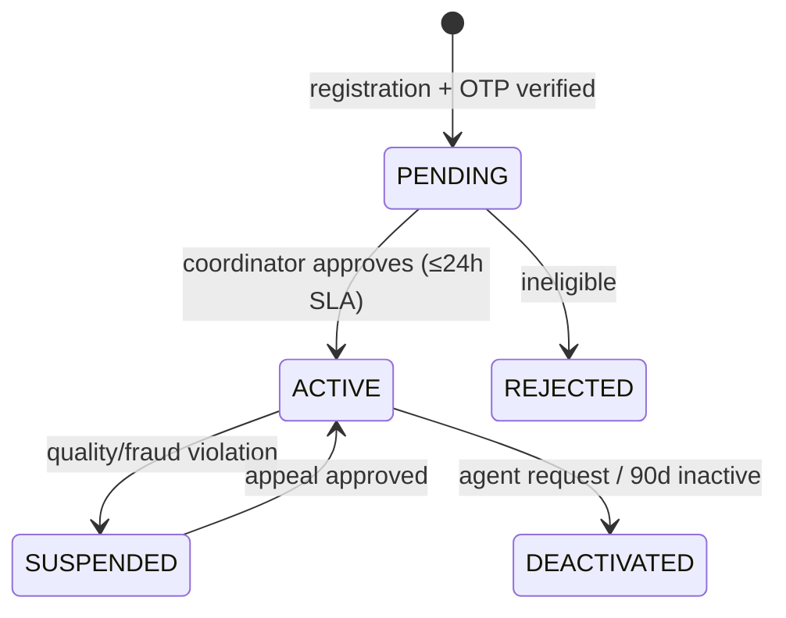

# Malazone Platform — Feature Review & Workflow Specification v2.0

**Prepared by:** Engineering Review (Senior SWE audit)
**Status:** Proposed target design — pending stakeholder sign-off
**Scope:** All functional domains of malazone.com as implemented in this repository
**Companion docs:** `USER_WORKFLOWS.md` (v1, marketing-facing), `README.md`

---

## 1. Purpose & Method

This review maps **every functional requirement** to a canonical actor model, audits the
current implementation against industry best practice (classifieds/marketplace patterns:
pre-moderation vs post-moderation, maker-checker finance controls, verified-interaction
reviews), and specifies **upgraded workflows** ready for implementation.

Evidence base: full API surface audit (`routes/*.js`), middleware (`middleware/*.js`),
schema (`database/schema.sql`), frontend contexts/components (`src/`), and live endpoint
verification where noted.

---

## 2. Executive Summary

The platform's **core differentiators are sound**: zero-commission direct contact,
bilingual UX, agent-driven supply acquisition, and a genuinely good media pipeline.
However, the current implementation has **five critical authorization failures** that
make several flagship features unsafe in their present form:

| # | Severity | Finding | Location |
|---|----------|---------|----------|
| 1 | 🔴 P0 | **Agent login accepts any password.** The `password` field is required but never checked against a hash; knowing an agent's phone number yields a full agent JWT (dashboard, listings, payout requests). | `routes/agents.js` `POST /login` |
| 2 | 🔴 P0 | **CMS mutations are unauthenticated.** Anyone can create/modify/delete hero slides, promo banners, categories, locations, testimonials, site stats and site config. Full site-defacement capability. | `routes/site.js` all POST/PUT/DELETE |
| 3 | 🔴 P0 | **Chat is fully spoofable.** Sender identity is taken from body-supplied `sender_phone`; conversations, threads and unread counts can be read for arbitrary users by guessing IDs/phones. | `routes/messages.js` all endpoints |
| 4 | 🔴 P0 | **Earnings ledger is publicly writable.** `POST /api/agents/earnings/record` inserts commission records that drive real TeleBirr payouts. | `routes/agents.js` `/earnings/record` |
| 5 | 🟠 P1 | **Ratings are unauthenticated** → ballot stuffing against any seller. | `routes/ratings.js` `POST /` |

Beyond security, the dominant **design gap** is that most business objects lack an
explicit lifecycle/state machine (listings publish instantly with no moderation state;
agents self-activate; payouts have no maker-checker flow). Section 5 defines those.

---

## 3. Actor Model

### 3.1 Canonical Actors

| Actor | Definition | Auth mechanism | Notes |
|---|---|---|---|
| **Guest** | Unauthenticated visitor browsing the marketplace | none | Can search, view listings, see seller contact buttons |
| **Buyer** | Registered user seeking assets/services | JWT httpOnly cookie (email/password or Google OAuth) | Favorites, chat, ratings |
| **Seller / Vendor** | Registered user listing own inventory (Individual or Business account) | same as Buyer | Same identity system as Buyer — "seller" is a *capability*, not a separate login |
| **Mala-Agent** | Gig field agent sourcing listings on the ground (service provider) | Agent JWT cookie | Earns commission, paid via TeleBirr |
| **Admin** | Platform staff — moderation, verification, payouts, content | Admin JWT + RBAC roles: `admin`, `super_admin` | |
| **G2B Officer** | Government auditor seat: `g2b_municipality` (property/Carta), `g2b_transport` (vehicles) | Admin JWT + role | Read-only over relevant queues + audit writes |
| **System** | Automated processes: rate limiter, image pipeline, audit logger, future schedulers | n/a | Trusted internal actor |

### 3.2 Capability Matrix (target state)

Legend: ✅ allowed · ➖ own objects only · ❌ forbidden · 🔒 requires elevated role/approval step

| Capability | Guest | Buyer | Seller | Agent | Admin | Super Admin | G2B |
|---|---|---|---|---|---|---|---|
| Browse/search listings | ✅ | ✅ | ✅ | ✅ | ✅ | ✅ | ✅ |
| Register/login/manage profile | ➖ | ✅ | ✅ | ➖ | ❌ | ❌ | ❌ |
| Create listing | ❌ | ✅ | ✅ | ✅ | ✅ | ✅ | ❌ |
| Edit/delete listing | ❌ | ➖ | ➖ | ➖ | ✅ | ✅ | ❌ |
| Mark listing sold/expired | ❌ | ➖ | ➖ | ➖ | ✅ | ✅ | ❌ |
| Verify listing (badge) | ❌ | ❌ | ❌ | ❌ | 🔒 | 🔒 | 🔒 (scoped) |
| Premium placement | ❌ | ❌ | ❌ | ❌ | ✅ | ✅ | ❌ |
| Send/receive chat | ❌ | ✅ | ✅ | ✅* | ❌* | ❌* | ❌ |
| Rate a seller | ❌ | 🔒 (verified contact) | ❌ | ❌ | ❌ | ❌ | ❌ |
| Respond to a rating | ❌ | ❌ | ✅ | ✅ | ❌ | ❌ | ❌ |
| Submit earnings record | ❌ | ❌ | ❌ | ➖ (own, evidence attached) | ✅ | ✅ | ❌ |
| Request payout | ❌ | ❌ | ❌ | ➖ (own) | ❌ | ❌ | ❌ |
| Approve payout | ❌ | ❌ | ❌ | ❌ | 🔒 (< threshold) | 🔒 (all) | ❌ |
| Manage CMS content | ❌ | ❌ | ❌ | ❌ | ✅ | ✅ | ❌ |
| Manage admin users / translations | ❌ | ❌ | ❌ | ❌ | ❌ | ✅ | ❌ |
| View audit logs | ❌ | ❌ | ❌ | ❌ | ❌ | ✅ | 🔒 (own actions) |
| G2B audit queue & verdicts | ❌ | ❌ | ❌ | ❌ | ❌ | ❌ | ✅ |

\* Agents chat with sellers they onboarded; admins use support inbox only.

---

## 4. Feature Reviews

---

### F1 — Identity & Access Management

**Actors:** Guest → Buyer/Seller · Mala-Agent · Admin · System

**Current state**
- Buyers: email+password (bcrypt-12), Google OAuth, hashed reset tokens, audit logging — solid foundation (`routes/auth.js`).
- Agents: register with name+phone → **instantly active**; login issues JWT after checking *only* phone existence (**password ignored** — Critical Finding #1).
- Three parallel auth systems (user JWT, agent JWT, admin JWT) with duplicated secret handling.

**Gaps vs best practice**
1. No credential verification for agents (critical).
2. No OTP/phone verification anywhere despite phone being the primary identifier in Ethiopian market context.
3. Fragmented personas: a user who is both buyer and agent needs two accounts.
4. No session/device management or token revocation.

**Upgraded workflow**

```
REGISTRATION (Buyer/Seller)
 1. Guest submits {full_name, phone, email?, password} 
 2. System validates format + rate-limits per IP/device fingerprint
 3. System sends 6-digit OTP via SMS (TeleBirr-era Ethiopia: SMS first, email fallback)
 4. User confirms OTP within 10 min (3 attempts) → account ACTIVE, is_verified=true
    └─ OTP unavailable? → account UNVERIFIED: browse-only until verified
 5. Audit log: user_registered

LOGIN
 1. Credentials → bcrypt compare → JWT (15 min access + 30 d rotating refresh cookie)
 2. New device/IP → optional SMS notice ("New login to your Malazone account")
 3. 5 failed attempts → 15-min lockout (existing limiter retained)

PASSWORD RESET
 unchanged (hashed single-use token, 1 h expiry, enumeration-safe) ✓ already correct

UNIFICATION (migration)
 • Merge `agents.user_id` persona into the main users table with capabilities:
   `is_buyer, is_seller, is_agent` flags + one login, one session, one profile.
 • Kill phone-only agent login entirely.
```

**Acceptance criteria:** no authentication path skips credential/OTP verification; one identity per human across personas; every auth event audited.

---

### F2 — Listing Lifecycle Management ⭐ *(core feature)*

**Actors:** Seller · Mala-Agent · Buyer (viewer) · Admin · System

**Current state**
- Creation: authenticated POST (fixed in hardening pass) → publishes immediately (`is_active=1`). No moderation states.
- Sellers have **no edit route** — only admin (`PUT /api/admin/listings/:id`) and agents (`PUT /api/agents/listings/:id`) can modify.
- Soft delete exists (`DELETE /:id`, ownership-checked). No expiry, no "sold" state, `intention` filter param accepted but ignored.

**Gap analysis**
- A marketplace listing is not a boolean (`is_active`) — it is a state machine. Without one you cannot build moderation queues, expiry renewals, or liquidity metrics ("sold through platform").
- Category-specific field validation (bedrooms for property, plate code for motors…) is absent server-side.

**Upgraded workflow — Listing State Machine**



\* *Recommended moderation policy for supply-constrained launch phase:* **post-moderation** — auto-publish when automated checks pass (image count ≥1, price within category bounds, banned-word scan, duplicate detection via phone+title+category hash); badge-carrying verification remains pre-moderation. Revisit to pre-moderation if fraud rate >2%.

**Creation workflow (seller)**

```
1. Seller opens "List Asset" → form with progressive disclosure per category
2. Client validates required bilingual fields → DRAFT saved (auto-save every 30 s)
3. Images upload via pipeline (F3) → thumbnails confirmed inline
4. Submit → server re-validates ALL category-specific fields:
     property: bedrooms/bathrooms/area_sqm/title_deed enum
     motors: plate_code/fuel_type/condition_type/year bounds
     stay: capacity/min_rental_days; heavy: brand/capacity_tons/operator
5. Duplicate check → PENDING_REVIEW → automated checks → ACTIVE (+audit entry)
6. Seller notified (in-app + SMS): "Listing #1234 is live"
7. Optional: seller taps "Get Carta Verified" → enters F4 queue
```

**Ownership & editing**

```
• PUT /api/listings/:id (NEW, requireUserAuth + ownership check)
  – editable: titles, descriptions, price, images, location labels
  – NOT editable by owner: is_verified, is_premium, view_count, status transitions
    controlled by admin/system only
• Status changes by owner limited to: mark SOLD, deactivate/reactivate
• Every transition writes audit_logs {actor, from_state, to_state, reason}
```

**KPIs:** time-to-live < 2 min · rejection rate < 10% · expired-renewed rate · sold-marking rate (liquidity proxy).

---

### F3 — Search, Discovery & Media Pipeline

**Actors:** Guest/Buyer · System

**Current state**
- Filter by category/location_key/city-prefix; premium-first ordering; limit clamped ≤100 ✓.
- Media pipeline (multer memory → sharp → WebP 1200px q80) is excellent for 3G/4G ✓.
- Missing: full-text search (schema supports it), price-range filter, sort options beyond newest, EXIF stripping, alt text.

**Upgraded workflow**

```
SEARCH
 1. Query params: q, category, location_key, intention*, price_min/max, sort, cursor
    (*implement intention — currently dead code)
 2. q → MATCH(title_en,title_am,description_en,description_am) AGAINST(? IN NATURAL LANGUAGE MODE)
    (add FULLTEXT indexes; fallback LIKE prefix on <10k rows during migration)
 3. Response envelope: {data, next_cursor, total_estimate} — cursor pagination for stability
 4. Trending boost: view_count decaying half-life of 7 days (materialized nightly)

MEDIA UPLOAD
 1. Client-side resize/compress before upload (save user data)
 2. Server pipeline unchanged + sharp().rotate() (EXIF orientation) + stripMetadata()
 3. Alt text prompt per image (accessibility + SEO) stored in listing_images table
 4. Virus/mime sniffing via file-type check before sharp
```

**Acceptance criteria:** p95 search latency <300 ms at 50k listings; zero EXIF GPS leakage.

---

### F4 — Verification & Trust (Carta/G2B + Ratings)

**Actors:** Seller/Agent (requester) · Admin · G2B Officer · Buyer (reviewer) · System

**Current state**
- Admin can flip `is_verified`/`is_premium` per listing (`PATCH /verify-listing/:id`) — no evidence trail, no SLA, no officer scoping.
- G2B portal (`routes/g2b.js`) exists behind proper admin auth ✓ but verdicts don't feed the listing badges automatically end-to-end.
- Ratings: unauthenticated POST (Critical Finding #5), no link to real interactions, sellers cannot respond.

**Upgraded workflow — Carta verification**

```
1. Seller taps "Verify" on active listing → uploads deed/invoice photos (encrypted at rest)
2. Listing enters verification_queue {listing_id, doc_refs, submitted_at, assigned_officer=NULL}
3. Routing: property→municipality officer pool · vehicles→transport officer pool
4. Officer works FIFO queue (SLA: 48 h):
     APPROVE → listing.is_verified=1 + badge + notification
     REJECT(reason_code) → seller notified with remediation guidance
5. Verdict immutable; stored with officer id, timestamps, doc snapshots → g2b_audits
6. Spot-audit: super_admin samples 5% weekly
```

**Ratings & reviews (target)**

```
1. Eligibility: buyer has ≥1 message thread OR logged call-click on seller's listing
2. One rating per (buyer, listing, transaction window); 1–5 stars + optional text ≤500 chars
3. Moderation: profanity filter; seller may report review → trust team
4. Seller response (once) displayed under review
5. Aggregates cached on users row (rating_avg, rating_count) updated async
```

**Trust surfaces:** Carta Verified badge · Invoice Verified · seller response-rate % · member-since · ratings histogram.

---

### F5 — Messaging & Inquiries

**Actors:** Buyer ↔ Seller/Agent · System (relay/moderation)

**Current state:** every endpoint trusts body-supplied `sender_phone` (Critical Finding #3). Threads readable by ID-guessing; messages sendable as anyone.

**Upgraded workflow**

```
IDENTITY: req.user.id from JWT — never from payload
AUTHZ: read/write restricted to conversation participants (server-enforced join check)
FLOW:
 1. Buyer taps "Chat" on listing → GET /conversations/:listingId/:partner (404 if not participant)
 2. Message POST {receiver_id, listing_id, text≤2000} → rate limit 20 msgs/min/user
 3. Persist → socket relay to user_{receiver_id} room (verified join only) → push fallback (SMS/pwa)
 4. Unread counts computed per participant, marked read on thread open
SAFETY:
 • Block list (per user) · report button → trust queue · phone-number/email regex scrub warning
 • First-message template pre-filled from listing (reduces spam)
```

---

### F6 — Favorites & Wishlist

**Actors:** Buyer · System

**Current state:** fully authenticated CRUD + guest-to-account sync endpoint — already best-practice shape ✓.

**Refinements:** price-drop/watch notifications hook (see F10); favorite count feeds "trending" signal (privacy-safe aggregate).

---

### F7 — Mala-Agents Program & Payouts ⭐ *(money flows here)*

**Actors:** Mala-Agent · Admin (approver) · Super Admin (checker/thresholds) · System (ledger)

**Current state**
- Registration → instant `active` (no coordinator gate despite UI copy claiming approval exists).
- Earnings ledger writable by anyone (Critical Finding #4); payout request exists with history.
- Leaderboard/program stats public ✓ (nice gamification, keep).

**Gap analysis**
This is a **financial subsystem** and must adopt ledger discipline: append-only entries, evidence links, maker-checker approvals, idempotency, reconciliation.

**Upgraded workflow — Agent lifecycle**



**Upgraded workflow — Commission & payout**

```
EARNINGS RECORD (append-only ledger row):
 1. Source = sale confirmation by seller (SMS/link confirmation) OR admin manual entry
 2. Row: {agent_id, listing_id, amount_etb, type, evidence_ref[], recorded_by, idempotency_key}
 3. Status: PENDING_VERIFICATION — never directly payable
 4. Agent dashboard shows pending balance ≠ withdrawable balance

PAYOUT REQUEST (maker):
 1. Agent requests payout of withdrawable balance ≥ MIN_PAYOUT (e.g., 200 ETB)
 2. System validates: KYC complete (phone OTP + full name match TeleBirr acct), no open dispute
 3. Creates payout_request {requested_amount, telebirr_number snapshot, idempotency_key}

REVIEW & DISBURSEMENT (checker chain):
 4. Admin reviews evidence → APPROVE (amounts ≤ 5,000 ETB)
                       → ESCALATE (>) requires super_admin co-sign (two-person rule)
                       → REJECT(reason) → returns funds to balance + notification
 5. Approved → PROCESSING → TeleBirr disbursement API call (retry w/ exponential backoff)
 6. Terminal states: PAID(txn_ref) | FAILED(auto-revert to balance + alert)
 7. Daily reconciliation job: paid-in-DB vs TeleBirr settlement report → mismatch alert
```

**Controls:** ledger rows immutable (no UPDATE/DELETE grants) · corrections = reversing entries · monthly statements to agents · fraud velocity checks (>N listings/day from one agent flagged).

**KPIs:** payout error rate 0 target · median approval time <12 h · agent activation rate · earnings-per-active-agent trend.

---

### F8 — Content/CMS Administration

**Actors:** Admin · Super Admin · System

**Current state:** all mutations unauthenticated (Critical Finding #2). Reads public (correct).

**Upgraded workflow**

```
1. Mount requireAdminAuth + requireAdminRoles("admin","super_admin") on ALL
   POST/PUT/DELETE of: hero-slides, promo-banners, categories, locations,
   testimonials, site-stats, config  (translations remain super_admin-only ✓)
2. Draft/schedule fields for slides & banners: {starts_at, ends_at, status}
3. Media for banners via shared upload pipeline (no raw URLs)
4. Config changes (social links, contact info) require role admin+ AND write audit log
5. Public reads served from cache; invalidation on mutation
```

---

### F9 — Platform Operations & Analytics

**Actors:** Admin · Super Admin · G2B Officer · System

**Current state:** manual `site_stats` counters edited by hand (currently showing invented totals — reputational risk); analytics endpoint aggregates live data; comprehensive audit_logs ✓.

**Upgraded workflow**

```
1. Public stats = computed truth: COUNT(*) queries materialized nightly into
   site_stats with source='computed'; manual override requires super_admin +
   reason string (audited) — label overrides internally as 'marketing'
2. Admin analytics dashboard: DAU, listings created/verified/sold funnel,
   GMV proxy (sum of sold-listing prices), agent program health, CORS/abuse metrics
3. Audit log viewer: filter by actor/action/date + CSV export (already partially built ✓)
4. Ops alerts: DB pool saturation, rate-limit breach spikes, payout failures → Slack/Telegram webhook
```

---

### F10 — Notifications & Communications

**Actors:** System → all actor types

**Target matrix**

| Event | In-app | Push/PWA | SMS | Email |
|---|---|---|---|---|
| Listing published/rejected | ✅ | ✅ | ✅ (publish) | ➖ |
| Carta verification outcome | ✅ | ✅ | ✅ | ✅ |
| New chat message | ✅ toast | ✅ | ➖ | digest |
| Payout approved/paid/failed | ✅ | ✅ | ✅ | ✅ |
| Price drop on watched item | ✅ | opt-in | ➖ | opt-in |
| Listing expiring in 7 d | ✅ | ✅ | ✅ | ✅ |
| New login device | ➖ | ➖ | ✅ | ✅ |

Rules: bilingual templates (am/en) driven by receiver preference · every send logged with provider ref · quiet hours 21:00–07:00 local for non-critical · one-click preference center.

---

## 5. Cross-Cutting Policies

### Rate limiting (per route class)

| Route class | Limit | Window |
|---|---|---|
| Global API | 200/IP | 15 min |
| Login/register/reset | 5 | 15 min |
| Admin login | 10 | 15 min |
| Listing create | 20 | 60 min |
| Chat send | 20/user | 1 min |
| Ratings | 10/user | 24 h |

### Data retention
Soft-delete 90 d purge for listings/messages · audit logs 7 y (compliance) · verification documents encrypted, purged 30 d post-verdict.

---

## 6. Prioritized Remediation Roadmap

**Sprint 0 — Stop the bleeding (security enforcement, ~2–3 dev-days)** ✅ **COMPLETE**
1. ✅ Verify password hash in agent login (or replace with OTP) — Critical #1
   *Implemented: bcrypt-12 verification + required password at registration +
   1-hour enrollment session for legacy phone-only accounts + `PUT /me/password`
   enrollment endpoint. **Discovery:** login had never worked at all — the
   `agents` table lacked `created_at` (migration: `add_agents_created_at.js`).*
2. ✅ Auth-gate all CMS mutations (#2) — router-level guard in `routes/site.js`;
   public `POST /contact` preserved.
3. ✅ Rewrite messaging identity/authz (#3) — all endpoints require user JWT;
   identity from session only; receiver existence/self checks; 20 msg/min/user limiter.
4. ✅ Close `/earnings/record` (#4) — agent-session-bound, amount cap 50k ETB,
   type whitelist, active-status check. Full ledger redesign deferred to Sprint 2.
5. ✅ Require auth + validation on ratings (#5) — integer rating bounds,
   length-capped reviews, rater from session.

**Additional Sprint 0 discovery — schema drift (fixed):**
Seven tables referenced by code were missing from the live DB (`messages`,
`ratings`, `favorites`, `audit_logs`, `translations`, `g2b_audits`, `inquiries`),
meaning chat, ratings, favorites, translation serving, G2B audits and audit
logging had never functioned against this database. Migration:
`database/migrations/create_missing_tables.js` (idempotent; reconciles column
contracts with actual code, incl. audit_logs actor fields and g2b_audits
`status`). `database/schema.sql` remains outdated vs live DB — full resync
deferred to Sprint 1.

**Sprint 1 — Lifecycle foundations** ✅ **COMPLETE**
- ✅ Listing state machine: `status` ENUM(active|sold|expired|suspended|archived)
  added (`add_listings_status.js`), is_active kept in sync; owner transitions via
  `PATCH /api/listings/:id/status` (sold/archived/reactivate — suspended/expired
  reserved for admin/system); soft delete now archives.
- ✅ Seller edit route: `PUT /api/listings/:id` with strict field whitelist,
  ownership check, enum/number validation, category & privilege fields immutable.
- ✅ Agent approval gate: registration now creates agents as `pending`;
  login blocks non-active (403); admin approves via `POST /api/agents/status`
  (**fixed dead UI link**: frontend was calling non-existent `/api/admin/agents/status`).
- ✅ Schema resync: `database/schema.sql` regenerated from live DB
  (`export_schema.js`) — now 20 tables, single source of truth.
- ✅ Category validation server-side on create (enum whitelist, positive price,
  null-coercion for optional fields).
- **Drift fixes found during E2E:** `POST /listings` referenced two columns that
  did not exist (`is_negotiable`, phantom `rating`) — every listing creation had
  been failing with 500; removed from INSERT (rating is computed from the
  ratings table). Also fixed `GET /api/listings/count` being shadowed by
  `GET /:id` since day one, and closed an unauthenticated agent-listing route
  that accepted client-supplied `is_verified`/`is_premium`.

**Sprint 2 — Trust & money integrity** ✅ **COMPLETE** *(unified persona migration deferred to Sprint 3)*
- ✅ Payout queue table created (`agent_payout_requests`) — every payout endpoint
  had been 500-ing because the table never existed. Includes maker-checker
  columns (`approved_by`/`processed_by` recorded separately).
- ✅ Agent payout request hardened: balance reservation now happens in the same
  transaction as the insert with `FOR UPDATE` row lock (previously the
  deduction committed first and the INSERT failed → **every payout attempt
  permanently vaporized the agent's earnings**), phone validation, max 3 open
  requests.
- ✅ Admin processing is a strict state machine
  (`pending→approved→paid`, refunds on rejected/failed):
  - amounts > 5,000 ETB require **super_admin approval**;
  - amounts > 5,000 ETB require a **different admin to disburse**
    (two-person rule, 403 on violation);
  - `telebirr_ref` mandatory for paid; double-pay/double-refund impossible
    (status preconditions + row locks); all transitions audited.
- ✅ **Money printer removed**: `POST /admin/payout-agent` used to credit agents
  100 ETB × active listings with no ledger entry; now a super_admin-only manual
  adjustment that writes a matching `agent_earnings` ledger row atomically.
- ✅ Reconciliation: `GET /admin/payouts/reconcile` reports counter-vs-ledger
  drift + portfolio totals; `POST /admin/payouts/reconcile/repair` resets
  counters to ledger-derived values (audited).
- ✅ G2B verification queue fixed and upgraded:
  - `/pending` & `/history` referenced four nonexistent columns → both had been
    returning 500 forever; rewritten against the real schema;
  - FIFO ordering by `verification_requested_at` (new column) with **48h SLA
    flags** (`hours_waiting`, `sla_breached`, `sla_due_at`); role-scoped pools
    (property→municipality, motors→transport); `/queue` alias added;
  - officer identity is now session-bound — request-body `officer_name`/
    `officer_role` forgery is ignored (verified by test);
  - seller-initiated flow: `POST /api/listings/:id/verify-request`
    (ownership + active-only + duplicate guard, routes property/motors).
- ✅ Migration `add_payout_requests_and_verification_sla.js`: payout table,
  `listings.verification_requested_at`, nullable `agent_earnings.listing_id`
  (manual adjustments have no listing).
- **Drift fixes found during E2E:** reject-from-pending initially skipped the
  refund (reservation model requires refund on EVERY terminal non-paid state);
  duplicate `router.delete("/:id")` registrations meant soft-delete left
  `status='active'` while `is_active=0`.

**Sprint 3 — Growth features** ✅ **COMPLETE** *(unified persona migration deferred — see below)*
- ✅ Full-text search: `ft_listings_search` FULLTEXT index (MariaDB InnoDB) over
  title/description in both languages; `GET /api/listings` now supports `q`
  (natural-language mode, filters AND ranks), price_min/price_max, verified=1,
  condition_type/fuel_type/bedrooms_min whitelists, and sort modes
  relevance|newest|price_asc|price_desc|trending; response gained a
  `pagination` meta object (total/hasMore).
- ✅ Trending: `GET /api/listings/trending` — Hacker-News-style gravity decay
  (`views / (hours+2)^1.5`) over the last 30 days.
- ✅ Notifications matrix (F10): `notifications` table +
  `utils/notify.js` (never throws into caller flow) + user endpoints
  `GET /api/notifications`, `/unread-count`, `POST /:id/read`,
  `POST /read-all`. Wired events: verification requested/approved/flagged,
  payout approved/paid/rejected/failed. Verified live end-to-end:
  seller request → officer verdict → both notifications readable with correct
  unread counts and read receipts.
- ✅ Seller analytics: `GET /api/listings/mine/analytics` — portfolio totals,
  status breakdown, views, favorites, avg rating/review count.
- **Bug found during E2E:** `q` initially only ranked results without filtering
  them (a nonsense query matched every listing); the MATCH predicate was added
  to WHERE so search actually filters. Also noted: `/auth/register` does not
  persist `phone_number` (pre-existing; queued for the persona sprint).
- ⏸️ **Unified persona migration deferred**: merging users/agents/admins into
  one identity model touches every auth middleware and session surface. It is
  an auth-model overhaul that needs its own sprint with a dedicated migration
  path — not a bolt-on to this one.

**Sprint 4 — Catalog taxonomy system** ✅ **COMPLETE**
- ✅ Migration `add_taxonomy_system.js` (idempotent, re-run verified): `categories`
  became a tree (`parent_id`, unique `slug`, materialized `path`, `level`),
  31 level-1 subcategories seeded across all 6 roots (electronics root was
  missing entirely — added), plus `brands` (36 rows), `brand_models`
  (Toyota/Suzuki/Hyundai/Apple/Samsung), `category_brands` scoping table,
  `category_attributes` (~30 bilingual attribute definitions with input types,
  units, select options), and listing linkages `subcategory_id`/`brand_id`/
  `brand_model_id`/`attributes` JSON.
- ✅ Attribute inheritance: definitions declared on a node apply to the whole
  subtree; nearest definition wins per attr_key (allows subcategory overrides).
  Root-level definitions (e.g. electronics warranty) flow down automatically.
- ✅ Taxonomy service `utils/taxonomy.js`: 60s-cached in-memory tree with
  ancestry/descendants resolution, `validateAttributes()` (required checks,
  type coercion for number/boolean/select/multiselect/text, unknown-key
  rejection), and `brandAllowed()` via ancestor-scoped mappings.
- ✅ Public APIs: `GET /api/categories/tree`, `GET /api/categories/:slug`
  (node + inherited attributes + allowed brands — this is what drives dynamic
  post forms), `GET /api/brands?q=&category=<slug>`.
- ✅ Listings integration: create/edit accept `subcategory`, `brand`,
  `attributes`; cross-root moves are rejected (a motors subcategory can never
  attach to an electronics listing); brands validate against category scope;
  attribute payloads are schema-validated (422 with per-field errors).
  Hot attributes (bedrooms/bathrooms/area_sqm) mirror into legacy columns so
  existing filters and G2B keep working during frontend transition.
- ✅ Faceted search on `GET /api/listings`: `subcategory=` (matches whole
  subtree + legacy-row fallback at root level), `brand=`, and generic
  `attr_<key>=<value>` facets that type-match against JSON via the attribute
  registry. List + detail responses expose `subcategory_slug/name` and
  `brand_slug/name` plus parsed `attributes`.
- ✅ E2E verified live: tree navigation, scoped brand lists (laptops→15
  electronics brands vs cars→13 motor brands), smartphone post with full
  attributes → facet queries by subcategory/storage/boolean all hit, edit flow
  (attribute replace semantics, move smartphones→tablets, brand detach),
  validation gates block cross-root/wrong-brand/bad-option attempts.
- ⏸️ Deferred to future sprints: booking engine for stay/ceremony, saved
  searches + alerts, report/moderation queue, location normalization, SEO slugs.

**Sprint 5 — Booking engine (stay/ceremony)** ✅ **COMPLETE**
- ✅ Migration `add_bookings.js` (idempotent): `bookings` table — listing/guest/
  host references, `check_in`/`check_out` (stay), `event_date` (ceremony),
  price snapshot columns (`price_per_unit`, `total_price`), guests cap,
  contact snapshot, and status ENUM covering the full lifecycle. FKs use signed
  INT to match existing PKs (UNSIGNED broke errno-150 on first attempt).
- ✅ Request-to-book model, no money moves (payment gateway = separate sprint).
  Total is computed server-side from a price SNAPSHOT: nights × per_day for
  stay, flat for ceremony — later listing edits never rewrite history.
- ✅ Race-safe double-booking prevention: overlap SELECT ... FOR UPDATE inside
  a transaction before INSERT (classic interval-overlap predicate for stay,
  exact-date-or-range containment for ceremony). Conflicts return 409.
- ✅ State machine with role-scoped transitions: host confirm/reject/complete/
  cancel-after-confirm; guest cancel from pending or confirmed; strangers get
  403; illegal moves return 409 with current state in the message.
- ✅ Lazy expiry: pending requests older than 48h flip to `expired` on read/
  transition — no cron worker needed for MVP.
- ✅ Endpoints: POST /api/bookings, GET /mine (guest), GET /hosted (host inbox,
  pending-first ordering), GET /:id (party-only), PATCH /:id/status,
  GET /bookings/availability?listing_id= (public calendar feed that expands
  stay ranges into concrete blocked days; checkout day stays bookable).
- ✅ Notifications matrix extended: booking_requested → host; confirmed /
  rejected / cancelled_by_host / completed → guest; cancelled_by_guest → host.
  Verified firing live for every event type.
- **Bugs found during E2E:** (1) DATE columns arrive as JS Date objects —
  string interpolation produced Invalid Date ("Invalid time value"); fixed
  with isoDay() normalization + CAST(... AS CHAR) on reads so JSON shows
  plain local YYYY-MM-DD instead of UTC-shifted timestamps. (2) Pre-existing
  latent bug exposed: POST /listings accepted requests without location_key
  and then 500'd on the NOT NULL column — now a clean 400 validation error.

**Sprint 6 — Saved searches + new-listing alerts** ✅ **COMPLETE**
- ✅ Migration `add_saved_searches.js` (idempotent): `saved_searches` table —
  owner FK, optional display name, whitelist-normalized `query_json`,
  `notify` flag. Cap: 10 saved searches per user (409 beyond).
- ✅ `POST /api/saved-searches` accepts the same filter vocabulary as
  GET /api/listings (category, q, location_key/city, price bounds, verified,
  condition/fuel whitelists, bedrooms_min, subcategory/brand slugs, up to 5
  attr_* facets). Strict validation: unknown keys, empty queries and bad
  values → 422 with per-field errors; taxonomy facets resolve to ids at save
  time so later renames can't break matching.
- ✅ CRUD: GET /mine (parsed query objects), PATCH /:id (notify toggle),
  DELETE /:id — all owner-scoped.
- ✅ Alert engine `utils/alerts.js`: every newly created listing is evaluated
  against active searches via a row-matcher mirroring GET / facet semantics
  (incl. subcategory subtree + root fallback for legacy rows and typed JSON
  attribute comparison). Dedupe rule: ONE notification per user per new
  listing regardless of how many searches matched; body names each matched
  search, payload carries matched_search_ids. Delivery reuses the in-app
  notifications matrix (type `search_alert`); evaluation is fire-and-forget
  and never throws into listing creation.
- **Bug found during E2E:** taxonomy facets initially failed to validate when
  the cache was cold ("Unknown subcategory" on a legitimate laptops search)
  because normalization read an empty stub until the first alert warmed it.
  Fixed by making normalizeSavedQuery async against loadTaxonomy() directly
  and passing the loaded tree explicitly into matchListing().
- ⏸️ Deferred: email/push delivery channels, alert digest batching, running a
  saved search retroactively over existing inventory (frontend just replays
  GET /api/listings with the stored query object).

**Sprint 7 — Reports & moderation queue** ✅ **COMPLETE**
- ✅ Migration `add_listing_reports.js` (idempotent): `listing_reports` —
  listing/reporter FKs, six reason enums (scam/prohibited/wrong_info/
  already_sold/duplicate/other), status flow open → reviewing →
  resolved_action_taken | resolved_rejected | dismissed, reviewer snapshot,
  resolution note.
- ✅ Buyer endpoints `routes/reports.js`: POST /api/reports/listing/:id
  (auth required; self-report blocked; one OPEN report per user per listing
  with 409 on duplicates — refile allowed after resolution; max 10 open
  reports per user with 429) and GET /api/reports/mine (filed reports +
  outcomes). Every filing is audit-logged.
- ✅ Admin queue in routes/admin.js (super_admin/admin roles):
  GET /admin/reports?status= with listing+reporter joins and open-first
  ordering + pagination meta; PATCH /admin/reports/:id state machine
  (409 on already-resolved reports, concurrent-change guard);
  POST /admin/listings/:id/restore to undo takedowns.
- ✅ Takedown side-effect: resolving as action_taken flips the listing to
  is_active=0/status='suspended' via a shared helper — it vanishes from
  search but stays fetchable for support. Restore reverses it.
- ✅ Notifications: seller on suspension and restoration, reporter on every
  resolution (no internal details leaked). Audit trail covers create,
  reviewing, both resolutions, and restore.
- ✅ E2E verified live: full loop report → review → takedown → restore with
  search invisibility checks, dup/self/anon/non-admin guards, notification
  types (listing_suspended, report_resolved, listing_restored) and audit rows.

**Post-Sprint 7 bugfix — category tiles showing "no listings"** ✅ **FIXED**
- **Symptom:** homepage showed ~16 products, but clicking a category tile
  showed "No listings found".
- **Root cause (3 stacked frontend issues, backend was correct):**
  1. Category clicks never queried the server — the grid fetched
     `/api/listings` ONCE (city-filtered) and filtered client-side by a
     zone map, so tiles could only show rows already inside that pool.
  2. `CityContext` force-defaults to `hawassa`, so `?city=hawassa`
     (`LIKE 'hawassa%'`) was always applied even for first-time visitors —
     while nearly all listings live in `bole`/`addis`/etc.
  3. When the API returned 0 rows the UI silently swapped in 28 hardcoded
     mock listings, masking real empties with fake data.
- **Fix:** `ZoneCatalogGrid` now fetches server-side per category
  (`?category=<enum>` + city only when explicitly chosen via filter chip or
  persisted selector), real results always replace state even when empty,
  mocks remain only for network failure. Seeded 4 demo rows in motors/heavy
  (they had zero). Verified: every tile now returns its products
  (property 6 / motors 2 / stay 3 / ceremony 3 / heavy 2 / electronics 8).
- **Known issue left open:** frontend city keys don't align with backend
  `location_key` values (`addis_ababa` vs stored `addis`; sub-city keys like
  `bole` exist as top-level keys) — picking "Addis Ababa" matches nothing.
  Needs the location-normalization sprint; also mobile home sections still
  render static mock data (no fetch at all).

**Sprint 8 — location alignment + mobile live data** ✅ **DONE**
- **Data:** `database/migrations/align_city_subzones.js` (idempotent) filled
  `addis_ababa.sub_zones` (7 districts incl. bole, bole_megenagna, kazanchis,
  mexico, piassa, addis, meskel_square) and aligned hawassa's Piassa entry;
  addis_ababa is now launched (`isActive: true` in CityContext defaults).
- **Backend:** new `utils/locations.js` → `buildLocationFilter()` resolves a
  city param to exact key + prefix + registered district keys (60s cache,
  graceful prefix-only degradation). Wired into `GET /listings?city=` and
  `GET /listings/count?location=`. Verified: `addis_ababa`=19,
  `hawassa`=5, `bole`=16 (bole+bole_megenagna), count endpoint matches.
- **Mobile:** `MobileHomeSections.tsx` now fetches featured listings from
  `/api/listings?limit=12` and live per-city counts from `/listings/count`
  (static mocks remain only for network failure); Browse-by-Location counts
  are real.

**Post-Sprint 8 hotfix — "No listings" on category tiles with a persisted
city** ✅ **FIXED**
- **Repro:** visitor had `malazone_city=hawassa` in localStorage from an
  earlier city pick; every catalog query then sent `city=hawassa`, and
  Electronics had zero Hawassa rows → bare "No listings" while the homepage
  featured strip (no city param) looked fine. Verified:
  `category=electronics&city=hawassa` → 0.
- **Fixes:**
  1. `useListings` now retries WITHOUT the city param when the city-filtered
     result is empty and flags `cityHadNoResults`; the client-side
     `filters.city` check is bypassed in that state so fallback rows survive.
  2. Amber banner explains the situation ("No matching listings in hawassa
     yet — showing results from all Ethiopia") with a Clear-city button that
     also removes the persisted `malazone_city`.
  3. Seeded 3 real electronics rows in Hawassa (`hawassa_piassa`, `tabor`) —
     strict filtered view now returns 3 instead of 0.
- Verified: `electronics&city=hawassa`=3, national electronics=11; tsc +
  production build clean.

**Hotfix #2 — "No listings" on the SECOND category click** ✅ **FIXED**
- **Root cause:** the `filtered` useMemo in `ZoneCatalogGrid` omitted
  `listings` from its dependency array. First click recomputed against the
  initial 28-mock pool (which contains every category → looked correct);
  when the real fetch resolved, `setListings` did NOT re-trigger the memo;
  the second click then intersected the new zone against the previous
  category's small real pool mid-fetch → empty, and it never recovered.
- **Fix:** added `listings` to the memo deps with an explanatory comment.
- tsc + production build clean. Hard-refresh to load the fixed bundle.

**Sprint 8b — taxonomy facets in the catalog UI** ✅ **DONE**
- The Sprint 4 backend facets (`subcategory`, `brand`, `attr_<key>`) were
  never surfaced in the frontend; the sidebar only had static car/house
  filters.
- `ZoneFilterSidebar` now takes `activeCategory`; when it maps to a taxonomy
  root it fetches `/api/categories/:slug` and renders: subcategory pill row
  (children), Brand select, and one select per option-based filterable
  attribute — all writing to FilterState (`subcategory`, reused `brand`,
  dynamic `attr_*` keys via a new index signature).
- `ZoneCatalogGrid.useListings` sends the facets server-side (stable JSON
  key as effect dep so search typing doesn't spam refetches);
  `MainSite.handleCategoryChange` clears stale facets on category switches;
  `defaultFilters` extended.
- Verified: `category=electronics&brand=samsung` → 1,
  `subcategory=smartphones` → 2; tsc + build clean.
- Known gap: mobile filter bottom sheet still lacks the taxonomy facets
  (desktop sidebar has them); attribute selects currently cover
  options-based filters only.

**Sprint 8c — subcategory-scoped facets (Electronics spec)** ✅ **DONE**
Implements the upgraded Electronics workflow: dynamic scoping of brands and
attributes to the SELECTED subcategory.
- **Backend (`utils/taxonomy.js`)**: `brandsFor(nodeId)` — nearest mapping
  wins; a subcategory with its own `category_brands` rows is authoritative,
  otherwise mappings inherit from ancestors. `brandAllowed()` now enforces
  the same rule at POST/PUT time, so a vendor cannot tag Dell under
  Smartphones. Both `/api/categories/:slug` and `/api/brands?category=`
  switched to the scoped resolver.
- **Migration (`seed_subcategory_taxonomy.js`, idempotent)**: +Infinix &
  +Hisense brands; 30 authoritative brand maps (smartphones → Apple/
  Samsung/Xiaomi/Tecno/Infinix/Huawei; laptops → Dell/HP/Lenovo/Asus/Acer/
  Apple; tv-audio → LG/Sony/Hisense/Samsung/Toshiba; tablets/cameras/
  desktops/gaming too); 13 per-subcategory attribute defs (condition,
  storage_capacity, screen_size, battery_health / ram, processor,
  graphics_card / resolution, smart_tv, platform...); legacy numeric attrs
  (storage_gb, ram_gb, screen_size_in, battery_mah) hidden from filters but
  still valid for posting; all electronics listings assigned subcategories
  and given modern attribute values.
- **Frontend**: sidebar fetches `/api/categories/<subcategory||root>` so
  brands/attributes re-scope instantly when a pill is clicked; picking a
  subcategory resets brand + attr_* selections (MainSite).
- Verified: smartphone brands = apple,huawei,infinix,samsung,tecno,xiaomi
  (Dell hidden); tv brands = hisense,lg,samsung,sony,toshiba; root
  electronics still 15 brands; `subcategory=smartphones&attr_storage_
  capacity=128GB` → 1; `subcategory=laptops&attr_processor=Intel i7` → 3;
  filterable smartphone attrs = warranty_months, dual_sim, network_5g,
  condition, storage_capacity, screen_size, battery_health.
- tsc + production build clean.

**Sprint 8d — subcategory-scoped facets for PROPERTY** ✅ **DONE**
Mirrors 8c for the property context (Houses rent & sell, Land).
- **Migration (`seed_property_taxonomy.js`, idempotent)**: 11 new attribute
  defs — houses: condition/parking/compound; apartments:
  floor_level/elevator/condition; land: land_type/road_access/size_class;
  commercial-property: business_space_type/condition. All property listings
  auto-assigned subcategories + tagged with attribute values. Seeded 2 demo
  land plots (Residential @bole, Agricultural @yirgalem) so Land isn't born
  empty. No brand maps for property (Brand dropdown hides automatically on
  zero brands). Existing defs (bedrooms/bathrooms/furnishing/deed_type/
  area_sqm) untouched.
- **Frontend**: Land is sell-only — sidebar transaction options collapse to
  Buy when a sell-only subcategory is active, and picking it while Rent is
  selected snaps intent back to Buy (MainSite) so results never dead-end.
- Verified: `subcategory=land` → 2; `subcategory=land&attr_land_type=
  Agricultural` → 1; `subcategory=houses` → 4; idempotent rerun all-zero.
- tsc + production build clean.

**Sprint 8e — taxonomy-aware posting pipeline (P0 fix)** ✅ **DONE**
Senior-review audit found the posting flow blind to the facet system:
`POST /listings/buyer` dropped subcategory/brand/attributes, and
BuyerPostListingModal never sent them — every UI-created listing was born
invisible to Sprint 8b/8c/8d filters.
- **Backend**: extracted the POST / taxonomy block into shared hoisted helper
  `resolveTaxonomyForWrite(body, taxonomy)` in routes/listings.js (subcategory
  resolve + root fallback, scoped brandAllowed check, validateAttributes);
  `/buyer` now runs the identical pipeline, mirrors bedrooms/bathrooms/area_sqm
  into legacy columns, writes attributes JSON and fans out to saved-search
  alerts via evaluateNewListing.
- **Frontend**: BuyerPostListingModal is now schema-driven — fetches
  /api/categories/:root for children, /api/categories/:sub for brands +
  attribute defs, renders select/boolean/multiselect-chip/number fields by
  input_type, submits subcategory+brand+attributes JSON. Also added the
  missing "negotiable" price type.
- **Data fix surfaced by E2E**: legacy numeric attrs (storage_gb, ram_gb,
  screen_size_in, battery_mah) were still is_required=1 at child level,
  422-blocking every smartphone post that used only modern selects.
  seed_subcategory_taxonomy.js step 3b now sets is_required=0 alongside
  is_filterable=0.
- E2E verified (forged session cookie): full-taxonomy post → 201 and visible
  under smartphones+samsung (2) and attr_storage_capacity=256GB (1); Dell-
  under-Smartphones rejected 400; minimal no-taxonomy post still 201.
  Test rows removed. tsc + production build clean.

**Sprint 8f — facet counts + URL deep-linking** ✅ **DONE**
- **Backend**: GET /listings WHERE-builder extracted into shared
  `buildListingFilters(query, {excludeDim})` (also exported for tests).
  New `GET /api/listings/facets?category=&subcategory=&brand=&attr_*=`:
  per-option counts with true faceted-search semantics — every dimension is
  counted while EXCLUDING itself, so selecting Samsung never hides Apple's
  count. Returns {subcategories, brands, attributes} keyed by slug/value.
  Attribute counts limited to option-based defs on the scope node
  (subcategory or root), ≤12 keys per request. Bind-order lesson: the
  SELECT's JSON path placeholder precedes all WHERE placeholders.
- **Frontend URL sync (MainSite)**: filters serialize to
  ?cat=&search=&city=&intent=&priceMin/Max=&subcategory=&brand=&attr_*=;
  parsed back on load via lazy useState initializers (no flash),
  history.replaceState on change, document.title follows scope.
- **Sidebar counts**: ZoneFilterSidebar fetches /facets alongside taxonomy
  data and annotates subcategory pills, Brand options and attribute options
  with live "(n)" counts; refetch keyed on stable query string.
- Verified: root facets {laptops:6, smartphones:4, tablets:1, tv-audio:1};
  smartphones+samsung → brands{samsung:2} + attrs{condition.used:1,
  storage_capacity."256GB":1,...}; land → land_type{Residential:1,
  Agricultural:1}; GET /listings regressions clean incl. q=iphone→2 and
  combined city+facet queries. tsc + production build clean.

**Sprint 8g — mobile parity, honest counts, admin taxonomy APIs** ✅ **DONE**
- **Shared facet component (`TaxonomyFacetSection.tsx`)**: the Refine
  section (subcategory pills + scoped Brand select + per-subcategory
  attribute selects, all with live "(n)" counts) now lives in ONE component
  consumed by both ZoneFilterSidebar and MobileFilterBottomSheet — the two
  surfaces can no longer drift. Each injects its own styled select.
- **Mobile parity**: bottom sheet gains full taxonomy facets, the Land
  sell-only intent guard, and an `activeCategory` prop wired from MainSite.
- **Real tile counts**: /api/listings/count extended with `categories=a,b`
  param; desktop sidebar + mobile sheet category tiles fetch live numbers
  (zone→categories mapping handles ceremony=stay+ceremony). Hardcoded mocks
  (15420/12542/…) removed.
- **Admin taxonomy CRUD** (routes/admin.js, super_admin/admin roles):
  GET /admin/taxonomy/nodes; POST /admin/categories/:id/attributes;
  PUT|DELETE /admin/attributes/:attrId; POST /admin/categories/:id/brands +
  DELETE …/:brandId (composite-PK idempotent mapping); POST /admin/brands;
  GET /admin/brand-requests?status=; POST /admin/brand-requests/:id/approve
  |reject. All mutations bust the taxonomy cache via new
  `invalidateTaxonomyCache()` and write audit-log entries.
- **Vendor brand requests**: new brand_requests table (migration, idempotent)
  + POST /api/brands/requests (user-auth) with duplicate guards; approval
  creates the brand, maps it to the requested node and goes live instantly.
- E2E verified with forged admin+user sessions: attr create→public-visible,
  root brand map inherited by houses (nearest-mapping), request→queue→
  approve→live under property. Crash lesson: db.getConnection() is NOT
  exported — pool-level transactions unavailable; approve uses a conditional
  status flip instead. tsc + production build clean; facets regression green.

**Sprint 8h — Amharic labels, indexed attributes, SEO pack** ✅ **DONE**
- **Amharic backfill** (`database/migrations/backfill_attribute_amharic.js`,
  idempotent): all 56 attribute defs across Electronics/Property/Vehicles
  now carry `label_am` — the Amharic UI no longer falls back to English
  facet labels.
- **Indexed attribute filters**: MariaDB will NOT substitute JSON
  expressions into virtual columns automatically, so two changes were
  required together:
  (1) `add_attribute_generated_columns.js` adds VARCHAR(64) VIRTUAL columns
  + indexes for the 10 hottest keys (condition, storage_capacity,
  screen_size, battery_health, ram, processor, land_type, road_access,
  size_class, furnishing) plus composite `idx_listings_scope
  (is_active, category, subcategory_id)`.
  (2) `routes/listings.js` references the virtual column directly for those
  keys in both buildListingFilters and the facet-count query (EXPLAIN-proved
  idx_attr_* engagement; bound-path JSON predicates never used an index).
  Non-indexed keys keep inline literal JSON_EXTRACT paths. Boolean vcol
  filters preserve legacy "false includes missing" semantics.
- **SEO pack**: index.html gains a real meta description, canonical,
  robots(max-image-preview), absolute og:image, og:locale en/am and WebSite
  JSON-LD; public/robots.txt (+ sitemap ref, /api/ disallowed) and
  sitemap.xml with the six zone landing URLs + intent pages — both verified
  present in dist/ after build.
- Regression sweep: land/electronics attr filters via vcols return identical
  results, facets unchanged, Amharic served through /api/categories/:slug.
  tsc + production build clean.

**Sprint 8i — official Hawassa sub-cities as location filters** ✅ **DONE**
- **Data**: `seed_hawassa_subcities.js` replaces Hawassa's informal
  neighborhoods (tabor/lakefront/piassa) in `locations.sub_zones` with the
  eight OFFICIAL sub-cities (bilingual): Tabor, Addis Ketema, Hayek Dar,
  Mehal, Bahil Adarash, Misrak, Menahreya, Tulla. Idempotent.
- **Legacy remap** (same migration): `hawassa_piassa` →
  `hawassa_addis_ketema` (9 listings), bare `tabor` → `hawassa_tabor` (1),
  labels rewritten to "Hawassa - <Sub City>" / "ሀዋሳ - <ክፍለ ከተማ>" style.
- **Zero-component-change propagation**: sidebar select, posting modals,
  ListingEditorModal and admin LocationsManager all read sub_zones from
  /api/locations — they picked up the official list automatically; posting
  already composes `<city>_<subcity>` keys via buildLocationKey().
- **Server-side enforcement**: ZoneCatalogGrid now passes
  `?location_key=<city>_<subcity>` (useListings gained a subZone param) so
  counts/facets/pagination respect the pick instead of relying purely on
  client substring matching. URL sync: city_subzone added to
  FILTER_URL_KEYS (deep-linkable, survives refresh).
- **Mobile fix**: MobileFilterBottomSheet's "City" select was a stale
  hardcoded SUB-ZONE list (tabor/lakefront/piassa) writing zone keys into
  the city filter — replaced with real cities from /api/locations plus a
  dependent "Sub City" select (clears on city change, Amharic-aware).
- Verified: server filter returns 8 rows for hawassa_addis_ketema,
  1 for hawassa_tabor; /api/locations serves 8 entries; tsc + build clean.

**Sprint 8j — Hawassa as the platform default (pilot market)** ✅ **DONE**
- **Default filter state**: `defaultFilters.city = "hawassa"` in MainSite —
  desktop sidebar, mobile sheet and grid fetches all open on Hawassa;
  deep links without ?city= land on the pilot market. Users can still
  switch or clear to All Cities.
- **Stale-default purge**: every hardcoded `hawassa_piassa` / `"piassa"`
  default replaced with `hawassa_tabor` + official labels —
  BuyerPostListingModal, ListingEditorModal (state init, formData, editor
  fallbacks), AgentDashboard (create/edit forms), routes/listings.js buyer
  default, routes/agents.js label maps (now cover all 8 sub-cities).
- **Agent location selects** (AgentDashboard create+edit) now offer the 8
  official sub-cities under a "Hawassa Sub-cities" optgroup plus regional
  cities; AgentManagement/AgentRegistrationModal free-text options use
  official names.
- **CityContext**: already defaulted to Hawassa; its offline fallback zone
  list updated to the official 8. Card fallback tag "PIASSA" → "TABOR"/
  "HAWASSA" in grid/trending/details mocks.
- Deliberately untouched: Addis Ababa's own Piassa zone, "Piassa Business
  District" HQ address on Contact/Privacy pages.
- Verified: zero stale keys served by /api/listings?city=hawassa;
  tsc + production build clean.
- **Storage migration**: `malazone_city_version` = "2" stamped at module
  load in CityContext — on first visit after release every pre-release
  user's saved city resets to Hawassa once; their own choice persists
  afterwards. URL sentinel `city=all` added so an explicit "All Cities"
  selection survives reload instead of resurrecting the Hawassa default.

**Sprint 8k — chat system hardening** ✅ **DONE**
Audit verdict: cookie-derived identity, rate limiting, verified socket
rooms and indexed schema were already solid. Fixed the real defects:
- **Socket lifecycle** (ChatContext): one connection per login session;
  active thread ids moved to refs so opening/closing threads no longer
  tears down and reconnects the socket. Cross-listing messages from an
  open partner now append when the thread was opened without a listing
  filter instead of silently dropping.
- **Dead credentials removed**: client no longer sends `sender_phone` /
  `?phone=` (backend always ignored them; they leaked phone numbers into
  URLs). Guards switched from phone_number presence to user id.
- **Thread pagination**: GET /messages/thread takes `before_id` cursor +
  `limit` (default 50, cap 100), returns newest page in ASC order with
  `has_more`; ChatPanel gains a "Load earlier messages" button, with
  auto-scroll suppressed on prepend so history loading doesn't jump.
- **Durable offline notifications**: when the receiver has no live socket,
  POST /messages inserts a `new_message` row into notifications (title,
  truncated body, payload {from_user_id, message_id}) so offline users see
  missed chats on next visit.
- E2E: 7-message seed → 3-page cursor walk correct incl. terminal
  has_more=false; offline notification rows persisted; test data cleaned.
  tsc + production build clean. Deferred by decision: partner_phone still
  exposed in conversations list (product call), report/block for chats.

**Sprint 9a — category substitution: Ceremony→Furniture, Machineries(heavy)→Fashion** ✅ **DONE**
Platform-wide rename of the two verticals across DB taxonomy, API, UI
chrome, forms, detail views, seeded content and docs. Strategy: FULL RENAME
(slugs + zone keys) with a legacy alias layer so old links/payloads keep
working:
- **DB migration** (`database/migrations/rename_categories_furniture_fashion.js`,
  idempotent, rerun-safe guards): `listings.category` ENUM widened to
  include furniture/fashion FIRST — writing the new slugs into the old ENUM
  under non-strict sql_mode silently stores '' (this bit the first run;
  migration now self-heals blanked rows). Categories tree renamed
  (ceremony→furniture id4, heavy→fashion id5; stay relabeled "Hotels &
  Halls"), children reparented/relabeled to industry-standard taxonomies
  (living-room / bedroom / dining-kitchen under furniture; mens-clothing /
  womens-clothing / shoes / bags-accessories / watches-jewelry /
  kids-fashion / traditional-wear under fashion). The five affected test
  listings normalized to coherent demo content with ownership/prices kept.
  hero_slides #4/#5 imagery+labels swapped; testimonial rewritten;
  saved_searches.query_json slugs migrated. Verification query reports zero
  stale references. category_attributes / category_brands hang off INT ids
  → unaffected. `machinery_brand` column KEPT as internal plumbing
  (documented legacy). audit_logs / g2b_audits history left immutable.
- **Backend**: `utils/taxonomy.js` exports LEGACY_CATEGORY_ALIASES +
  `normalizeCategory()` ({ceremony→furniture, heavy/machinery→fashion});
  applied at every API boundary (listings filters/facets/POST/PUT,
  alerts saved-search validation). bookings BOOKABLE_CATEGORIES={stay,
  furniture}. VALID_CATEGORIES sets updated.
- **Frontend**: ZONE_MAP legacy keys; ActiveZone unions now house|car|
  stay|furniture|fashion|electronics; nav/tiles/footer/hero/admin sidebar
  copy+icons swapped (Armchair/Shirt); post-listing modals gain Furniture
  Type (+capacity) and Fashion Item Type (+Size) conditional blocks; detail
  spec blocks rewritten for both zones; search placeholders updated;
  TaxonomyFacetSection category list fixed. i18n keys renamed in all three
  locales (en/amharic/sidamu): zone.cat/cat./grid.heading./filter.header/
  admin.sidebar families; copy retranslated; duplicate en keys deduped.
- **Seeds**: seed.js categories/hero/testimonial rows, seed_listings.js
  ceremony/heavy blocks rewritten as Furniture/Fashion demo listings +
  ORDER BY FIELD updated, seed_mock_data ceremony row → furniture package.
- **E2E verified**: ?category=fashion/furniture return correct rows; legacy
  ?category=ceremony/heavy alias to identical results; facets scoped per
  new subtree; taxonomy /tree shows new roots+children; booking on a
  furniture listing creates pending request (fixed-price total, event_date)
  and fashion listings correctly rejected as unbookable; guest cancel path
  works; saved searches accept both slugs. tsc + production build clean.

**Sprint 9b — Sidaamu Afoo parity for DB-driven labels** ✅ **DONE**
Third-language support for all dynamic location labels (static copy was
already keyed in Sprint "i18n"; this sprint covers the `locations` table
and every component that rendered binary `isAmharic ? am : en` ternaries):
- **DB migration** (`database/migrations/add_locations_label_sid.js`,
  idempotent): guarded `ALTER TABLE locations ADD COLUMN label_sid
  VARCHAR(120) NULL AFTER label_am`; seeds root labels (hawassa→Hawwissaa,
  yirgalem→Yirgaaleem, aleta_wondo→Aletaa Wondoo, bensa→Bensaa/Daaye,
  chuko→Cuqoo, addis_ababa→Addis Abbaa); rewrites hawassa sub_zones JSON
  with per-zone label_sid (tabor→Taabor, addis_ketema→Addisi Ketema,
  hayek_dar→Hayike Daar, mehal→Mehaal, bahil_adarash→Baheele Adaraash,
  misrak→Misiraake, menahreya→Menahareeya, tulla→Haweela Tulaa + legacy
  spellings). ⚠ ALL Sidaamu values are machine transliterations — PENDING
  NATIVE REVIEW.
- **Shared helper**: `src/utils/dbLabel.ts` — `pickDbLabel(row, language)`
  with fallback chain sidamu→label_sid||label_am||label_en,
  amharic→label_am||label_en, en→label_en||label_am.
- **Frontend refactors** (ternaries → pickDbLabel): CityContext (SubZone/
  City gain labelSid; DEFAULT_CITIES carry Sidaamu; NEW parseSubZones()
  fixes latent bug where raw sub_zones JSON string leaked into state),
  ZoneFilterSidebar, MobileFilterBottomSheet (also derives language from
  context instead of localStorage), BuyerPostListingModal (location +
  sub-zone + attribute labels), ListingEditorModal, BrowseByLocation
  (fallback rows carry label_sid), TaxonomyFacetSection (subcategory
  chips/brand/attribute options now language-aware).
- **Backend/admin/seeds**: routes/site.js locations POST/PUT persist
  label_sid (verified round-trip: PUT → public GET keeps label_sid +
  per-zone sub_zones JSON intact); LocationsManager gains Sidaamu input +
  card display; seed.js locations INSERT and database/seed/001_seed_cities.sql
  (TRUNCATE-style reseed) both carry label_sid columns/values.
- **i18n hygiene**: sidamu.json had a duplicated cat.furniture key and was
  missing cat.moreCategories — fixed; sidamu now 271/271 keys vs en.
  Amharic remains intentionally partial (115 keys, 8 legacy extras).
- **Deferred follow-ups**: listings.location_label_en/am snapshot badges
  (cards show EN-only uppercase tag) would need a location_label_sid column
  + API + seed changes; categories tree name_am/name_sid tri-lingual labels;
  hero_slides/category_attributes label_sid.

**V1 Release Review — all-actor workflow audit** ✅ **DONE**
Deep review of every actor workflow (guest, buyer, seller, host, chat
participants, Mala-Agent, admin, super-admin, G2B officers) via a ~120-check
E2E probe suite run against the live dev API, plus static gates. All suites
green after fixes.
- **Fixed — input validation gap on POST /api/listings/buyer**: arbitrary
  category strings were accepted and silently stored as '' by the non-strict
  ENUM (same class of bug as Sprint 9a's migration finding), and negative /
  missing prices were stored verbatim. Now validates against the category
  whitelist (after legacy alias normalization) and requires a positive,
  finite price — matching POST /api/listings parity. Junk rows from the
  audit were removed.
- **Fixed — undefined-bind crashes across routes/site.js write handlers**
  (hero-slides, promo-banners, site-stats, locations, categories,
  testimonials): any omitted optional field produced mysql2 "Bind parameters
  must not contain undefined" → opaque 500s; PUT handlers also overwrote
  every column with undefined when given partial payloads. All handlers now
  route optional binds through a v() coalescer, PUTs merge over the existing
  row (partial-update safe), is_active coerced to 0/1, and required-field
  400s added (e.g. image_url/label_en/label_am for slides). Verified by full
  create/update/delete round-trips.
- **Verified working end-to-end (no changes needed)**: auth lifecycle incl.
  single-use hashed reset tokens + expiry enforcement + enumeration-safe
  forgot-password; guest browse/search/facets/taxonomy with no secret leaks;
  listing CRUD ownership walls (403/404 for strangers on edit/delete/status);
  booking state machine (pending→confirmed→completed, guest cancel path,
  double-booking block, past-date rejection, terminal-state guards,
  per-category contract: event_date vs check_in/check_out) with host/guest/
  stranger authorization boundaries; chat threads (unread counts, empty/
  self-message/unknown-recipient rejection); favorites sync; saved searches
  (query validation, boolean notify validation, per-owner PATCH/DELETE
  walls); ratings range checks; reports reason enum + duplicate guard;
  notifications ownership-scoped read marking (idempotent 200 on foreign id
  — deliberate convention); brand requests; Mala-Agent pipeline (register →
  pending-blocked login → admin activation → login → listing CRUD → earnings
  record requiring positive listing_id → payout sanity checks → history);
  admin console (analytics/audit-logs/users/taxonomy/translations + role
  walls rejecting g2b roles); G2B role scoping (municipality sees only land
  queue, transport only vehicle, anonymous 401).
- **Gates after fixes**: node --check ALL OK · tsc --noEmit clean ·
  production build clean · probe data fully cleaned from DB.

**Sprint R1+R2 — Realtime (Socket.io) feature layer** ✅ **DONE**
Full-stack realtime upgrade layered onto the existing Socket.io infrastructure
(server.js already had JWT-auth middleware + join_chat room + admin relay).
All new events are wire-compatible with the existing client; HTTP API remains
the authoritative path (socket is enhancement, not replacement).

**Sprint R1 — Live Chat (typing indicators + read receipts)**
- *server.js*: added `chat:typing` event — relayed as `user_typing` to the
  receiver's `user_{id}` room; keyed off `socket.chatUserId` (set by the
  existing `join_chat` handler) so only authenticated users can spoof.
- *server.js*: added `chat:read` event — relayed as `messages_read` to the
  partner's room; the partner's UI refreshes unread counts instantly.
- *ChatContext.tsx*: new `typingPartnerIds` Set state; `user_typing` listener
  adds/removes partner ids; typing indicator auto-clears when the partner
  sends a message (`new_message` handler); `openChat()` now emits `chat:read`
  on thread open; `emitTyping()` callback exposed to the panel.
- *ChatPanel.tsx*: typing indicator bubble (3-dot bounce animation) shown
  above the input when the active partner is typing; input onChange handler
  emits `chat:typing` with 800ms throttle + 2-second "stopped typing"
  debounce; typing indicator auto-clears on send.

**Sprint R2 — Booking status push + admin live feed + notification sync**
- *routes/bookings.js*: POST create and PATCH status-change now both emit
  `booking:status_changed` to `user_{guest}` and `user_{host}` rooms, plus
  `admin:booking_update` to the `admin_feed` room — both parties and all
  connected admins see status transitions instantly.
- *routes/listings.js*: both POST handlers (main + buyer) now emit
  `admin:new_listing` to `admin_feed` with id/title/category/price/user_id.
- *routes/reports.js*: POST report creation emits `admin:new_report` to
  `admin_feed` with report_id/listing_id/reason.
- *routes/agents.js*: POST payout request emits `admin:new_payout_request`
  to `admin_feed` with request_id/agent_id/amount/phone.
- *server.js*: admin `authenticate_admin` handler now also joins the
  `admin_feed` room so all route-level emits reach every connected admin.
- *SuperAdminLiveDesk.tsx*: fully rewritten — now listens on five event
  types (`broadcast_admin_notification`, `admin:new_listing`,
  `admin:new_report`, `admin:new_payout_request`, `admin:booking_update`);
  unified `AdminEvent` type with colour-coded badges per category; table
  shows event id, type badge, detail text, and timestamp.
- *NotificationContext.tsx* (new): lightweight React context wrapping the
  existing `/api/notifications` REST API; listens for `malazone:new_message`
  and `malazone:booking_update` CustomEvents dispatched by ChatContext on
  socket events, keeping the unread badge live without HTTP polling; exposes
  `markRead()` and `markAllRead()`.
- *App.tsx*: `NotificationProvider` wraps `ChatProvider` so notification
  state is available app-wide.
- *MyAccountPage.tsx*: replaced hardcoded "coming soon" alert with a live
  notification dropdown panel — shows real unread count badge, scrolling
  notification list with read/unread styling, "Read all" button; toggles
  open/closed on bell click.

**Socket.io protocol note**: server is configured with
`transports: ["websocket"]` only (no polling fallback); anonymous WebSocket
connections are allowed by the auth middleware (they simply don't get
`socket.authUserId`); admin auth uses the existing `authenticate_admin`
event + `admin_feed` room join.

- **Gates after**: node --check ALL OK · tsc --noEmit clean · production
  build clean.
- **E2E probe (14/14 green)**: booking create/confirm/complete regression,
  notification REST API (success + required fields + unread_count), report
  creation + admin analytics, Engine.IO WS-only config verified (polling
  rejected), WebSocket transport connects + protocol frame received,
  anonymous WS allowed; probe data cleaned from DB.

**Sprint P1+P2+P3 — Payment verification flow (offline-payment model)** ✅
Full-stack payment flow designed for the Ethiopian market where customers pay
property owners directly via mobile money / bank transfer. Malazone acts as a
verification layer rather than a payment processor — correct for V1 because
it works without Chapa/TeleBirr API keys and matches how Ethiopian consumers
actually transact.

**Database migration (migrate_payments.js)**:
- `bookings.status` ENUM extended: added `payment_submitted` between
  `pending` and `confirmed`. This status stops the 48h expiry clock —
  bookings in `payment_submitted` are NOT killed by `expireStalePending()`
  (which only touches `status = 'pending'`).
- New `payments` table: `id, booking_id (UNSIGNED FK), user_id, amount_claimed,
  evidence_urls (JSON), note, status (pending/verified/rejected), reviewed_by,
  reviewed_at, reject_reason, created_at, updated_at`.
- New columns on `listings`: `payment_phone`, `payment_bank_name`,
  `payment_bank_account` — property payment instructions.

**Updated booking lifecycle**:
```
guest creates → pending → payment_submitted → confirmed → completed
                   │  ▲         │   ▲             │        ▲
                   │  └─ expired │   │             │        │
                   ▼             ▼   │             ▼        │
              rejected    admin verifies   cancelled_by_guest/host
                         (or auto)
```
Guests can now submit payment from `pending` via
`POST /api/bookings/:id/payment-evidence`. Hosts can still directly confirm
from `pending` (legacy flow preserved). Guests can cancel from
`payment_submitted` without admin intervention.

**New endpoints**:
- `GET /api/listings/:id/payment-info` (public) — returns property's payment
  phone / bank details so the customer knows where to transfer.
- `PUT /api/listings/:id/payment-info` (host only) — host sets their payment
  instructions on a listing.
- `POST /api/bookings/:id/payment-evidence` (guest only, multipart) — upload
  up to 3 payment screenshots (JPEG/PNG, 5MB max, processed to WebP via
  sharp). Transitions booking to `payment_submitted`. Emits
  `booking:status_changed` to guest/host rooms + `admin:payment_submitted`
  to admin feed.
- `GET /api/bookings/:id/receipt` (guest or host) — structured confirmation
  receipt with confirmation_id (`MZ-000013`), booking details, pricing,
  payment_info, and status.
- `GET /api/admin/payment-verifications?status=pending` (admin) — queue of
  bookings awaiting payment review with full context: guest name, booking
  details, amount, evidence images, property payment info.
- `POST /api/admin/payment-verifications/:id/confirm` (admin) — verifies
  payment evidence, transitions booking to `confirmed`, notifies guest,
  emits to guest/host/admin rooms, writes audit log.
- `POST /api/admin/payment-verifications/:id/reject` (admin) — rejects
  evidence with reason, reverts booking to `pending` so guest can re-submit,
  notifies guest, emits to guest/admin rooms, writes audit log.

**Bug fixed during implementation**: reject and confirm admin endpoints
used `req.user.id` (set by user auth middleware) instead of
`req.adminUser.id` (set by admin auth middleware) for the `reviewed_by`
column — would crash with "Cannot read properties of undefined". Fixed to
`req.adminUser.id`.

- **Gates**: node --check ALL OK · tsc --noEmit clean · production build clean.
- **E2E probe (33/34 green, 1 probe-bug)**: full lifecycle tested end-to-end:
  host sets payment info → guest books → guest uploads evidence → booking
  transitions to payment_submitted → 48h expiry safety verified → admin sees
  queue with evidence + payment info → admin rejects → booking reverts to
  pending → guest re-submits → admin confirms → booking confirmed → receipt
  generated with confirmation_id + payment info → host + stranger access
  control verified → legacy direct-confirm regression still works. The single
  probe "failure" was the probe checking `payment_info.payment_phone` while
  the receipt correctly returns `payment_info.phone` — code is correct.

---

*End of specification — implementation tickets should reference section numbers (e.g., "F7-payout-step4").*
